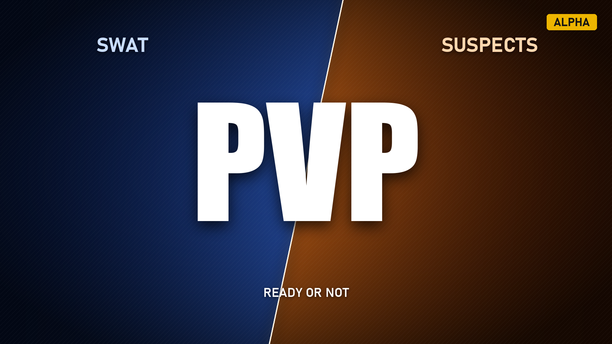

<p align="center"></p>

# Ready or Not PvP — SWAT против подозреваемых

   

> [!WARNING]
> **Это альфа-версия.** Режим играбелен, но в нём есть ошибки, а с живыми соперниками он проверен мало.
> Нашли ошибку или вылет — **напишите в [Issues](https://github.com/VolkovIlia/ReadyOrNot-PvP/issues/new/choose)**
> и приложите логи (как их найти — [ниже](#сообщить-об-ошибке)). Каждый отчёт помогает.
>
> **Alpha version.** Bugs are expected. Please report them in [GitHub Issues](https://github.com/VolkovIlia/ReadyOrNot-PvP/issues/new/choose). [English summary below](#english).

Мод превращает любую ко-оп миссию Ready or Not в PvP: игроки SWAT против игроков-подозреваемых, раунды и смена
сторон как в CS2. Ставит его **только хост**. Есть две версии:

| | Меню «Моды» (pak) | Установщик (UE4SS) |
|---|---|---|
| Установка | подписка в меню «Моды» игры | `Install.bat` из архива |
| Друзьям | один раз включить «Подключаться к серверам с модами» (или подписаться) | ничего |
| Запреты подозреваемым (доклады, крик) | нет | есть |
| Всплывающие очки миссии | остаются | скрыты |
| Наблюдение после смерти | за кем угодно | только своя команда |

Остальное одинаково: меню команд, раунды, вселение, снаряжение, боты, лобби на 10 игроков.

## Возможности

- **Выбор команды в духе CS2** на экране подготовки любой ко-оп миссии: карточки SWAT и подозреваемых, игроки,
  боты, настройки матча, «Готов».
- **Раунды.** Матч до N побед (по умолчанию 3). Раунд кончается внутри миссии, затем миссия загружается заново.
  Свой экран итогов раунда и матча вместо штатного экрана SWAT, смена сторон в перерыве.
- **Игроки-подозреваемые** появляются на месте ИИ-подозреваемых, с оружием и одеждой подозреваемых, без брони и
  SWAT-снаряжения. После смерти через 10 с вселяются в другого живого ИИ-подозреваемого, пока такие есть.
- **Боты SWAT** по желанию: ИИ-отряд воюет за SWAT, а без игроков SWAT сам охотится на подозреваемых.
  Можно играть одному против ботов за любую сторону.
- **Честные правила:** подозреваемые не арестовывают, не кричат «на пол», не докладывают в TOC и не получают
  SWAT-очки; гражданские нейтральны; наблюдение после смерти — только за своей командой.
- **Лобби до 10 игроков** (5 на 5) вместо штатных 5.

## Установка через меню «Моды» (pak)

1. В главном меню игры откройте «Моды», найдите **PvP - SWAT vs Suspects** и подпишитесь, затем перезапустите игру.
   Без меню: скачайте `RoNPvP-…-modio.zip` со страницы [Releases](https://github.com/VolkovIlia/ReadyOrNot-PvP/releases)
   и положите `RoNPvP.pak` в `<папка игры>\ReadyOrNot\Content\Paks\~mods\`.
2. Друзьям: подписаться на мод **или** один раз включить «Настройки → Игра → Подключаться к серверам с модами» —
   игра помечает лобби хоста с модами как «модифицированное» и без этого его не показывает.
3. Начните ко-оп миссию — на экране подготовки откроется меню команд.

Pak-версия работает без UE4SS: логику запускает штатный механизм модов игры (`ModActorSpawnData`). Если стоит и
UE4SS-версия, она уступает миссию pak-версии.

## Установка установщиком (UE4SS)

1. Закройте игру.
2. Скачайте `RoN-PvP-…-alpha.zip` со страницы [Releases](https://github.com/VolkovIlia/ReadyOrNot-PvP/releases/latest)
   и распакуйте в любую папку.
3. Запустите **`Install.bat`**. Он сам найдёт игру в Steam и поставит мод вместе с загрузчиком
   [RE-UE4SS](https://github.com/UE4SS-RE/RE-UE4SS). Если UE4SS уже стоит, установщик его не трогает.
   - Если Windows спросит про неизвестного издателя: «Подробнее» → «Выполнить в любом случае».
   - Если игра не нашлась, установщик попросит путь: Steam → Ready or Not → «Управление» → «Просмотреть локальные файлы».
4. Запустите игру и начните ко-оп миссию — на экране подготовки откроется меню команд.

Удаление — `Uninstall.bat` из того же архива: он убирает мод и UE4SS, если тот не нужен другим модам.
Обновление — запустить `Install.bat` новой версии, настройки сохранятся.

<details>
<summary>Ручная установка</summary>

1. Поставьте [RE-UE4SS experimental](https://github.com/UE4SS-RE/RE-UE4SS/releases/tag/experimental-latest)
   (проверено с `v3.0.1-1183-gcdbc0b66`): содержимое архива — в `<папка игры>\ReadyOrNot\Binaries\Win64\`,
   рядом с `ReadyOrNotSteam-Win64-Shipping.exe` должны лечь `dwmapi.dll` и папка `ue4ss`.
2. Из архива мода скопируйте `game\ue4ss\Mods\HostBrain` в `<папка игры>\ReadyOrNot\Binaries\Win64\ue4ss\Mods\`.
3. В `ue4ss\UE4SS.log` после запуска игры должна быть строка `[HostBrain] … loaded`.
</details>

Антивирус может ругаться на `dwmapi.dll` — это загрузчик UE4SS, так он встраивается в игру.
Консоль игры (`~`) нужна только для команд из раздела [«Команды хоста»](#команды-хоста); её включает встроенный в
UE4SS `ConsoleEnablerMod`.

## Как играть

1. Хост запускает игру с модом, создаёт лобби в «Игра по сети», друзья заходят. Лобби на 10 мест создаётся после
   загрузки мода.
2. Хост выбирает любую ко-оп миссию (например, «Слон» на кампусе). На экране подготовки у хоста открывается меню
   «Выберите команду»:
   - «Вступить» в карточке SWAT или подозреваемых, «Автовыбор» — в меньшую команду;
   - настройки: боты SWAT, их меткость, время раунда (3–30 мин), «Матч: до N побед», смена сторон;
   - «Готов» — миссия ждёт эту кнопку.

   Остальные игроки выбирают сторону в чате: `!suspect` или `!swat`, состав команд — `!teams`.
3. Начинается раунд. Если подозреваемых никто не выбрал, идёт обычная ко-оп миссия.
4. После раунда у хоста страница итогов со счётом и отсчётом; через 8 с следующий раунд стартует сам.
   После решающего раунда — «Матч окончен» и кнопка «Новый матч».

Одному: начать ко-оп миссию, в карточке подозреваемых нажать «Вступить», затем «Готов». Вы воюете вместе с
ИИ-подозреваемыми против ИИ-отряда SWAT, а после смены сторон — за SWAT с ботами.

## Правила

- **SWAT** играют по обычным правилам миссии и в раунде не возрождаются. SWAT берёт раунд, когда нейтрализованы все
  ИИ-подозреваемые и игроки-подозреваемые, а вселяться больше некуда.
- **Подозреваемые** берут раунд, если выбыли все игроки SWAT (боты не считаются; без игроков SWAT — весь ИИ-отряд)
  или вышло время раунда.
- **Раунды.**
  - Раунд кончается внутри миссии, без штатного экрана итогов: итог приходит всем в чат, через 6 с миссия
    загружается заново.
  - Смена сторон после N−1 раунда (в матче до 3 побед — после второго), счёт переходит вместе с игроками.
- **Подозреваемый** появляется на месте случайного ИИ-подозреваемого, этот ИИ уходит из миссии.
  - Оружие соответствует оружию ИИ (AKM → SLR-47, G3 → FAL, Makarov → M92 и т.п.).
  - Брони, шлема, ПНВ, гранат и SWAT-устройств нет. Одежда — штатный образец игры для игрока-подозреваемого;
    сохранённую внешность игрока это не меняет.
- **Вселение.** Через 10 с после смерти игрок вселяется в живого ИИ-подозреваемого, которого не видит ни один SWAT
  и который дальше 10 м от них. Когда ИИ кончились, игрок до конца раунда наблюдает за своими.
- **Запреты для подозреваемых.** Нельзя кричать «на пол», докладывать в TOC, арестовывать и уводить гражданских,
  взаимодействовать с персонажами. Двери, лестницы и предметы доступны.
- **Без очков миссии.** Пока идёт матч, всплывающие «+N» очков не показываются никому.

## Команды хоста

Меню закрывает всё нужное для игры; консоль — для тонкой настройки.

```
comp_pvp here|<карта> [минуты] [bots|nobots]   включить режим вручную (here — на этой миссии)
comp_pvp_auto on|off              меню команд на экране подготовки любой ко-оп миссии (по умолчанию вкл.)
comp_pvp_team <игрок|me> swat|suspect
comp_pvp_time 10 10               время раунда, мин, и задержка вселения, с
comp_pvp_bots on|off [меткость]   ИИ-отряд SWAT и его меткость (1 = обычная, больше = хуже)
comp_pvp_rounds [побед] [0|1]     матч до N побед и смена сторон
comp_pvp_endround swat|suspects   закончить идущий раунд победой стороны
comp_pvp_status / comp_pvp_end    состояние / выключить режим
comp_maxplayers [n]               мест в следующих лобби (по умолчанию 10, до 16)
comp_status                       версия мода, защита, состояние игры
```
Настройки сохраняются в `Mods\HostBrain\settings.txt`.

## Известные ограничения

- Меню и сообщения мода пока только на русском.
- Сетевая игра с живыми соперниками проверена мало: смотрите [чек-лист](docs/pvp-playtest.md).
- У клиентов-подозреваемых остаётся панель отряда SWAT: у ванильного клиента её не скрыть.
- Анимация и голос доклада по рации у самого подозреваемого проигрываются, но сервер доклад не принимает.
- Если в раунде погибли все игроки, может на секунду мелькнуть штатный экран итогов перед загрузкой следующего раунда.
- Обновление игры может сломать мод: он опирается на внутренние функции игры.

## Сообщить об ошибке

[Создайте issue](https://github.com/VolkovIlia/ReadyOrNot-PvP/issues/new/choose) и приложите с машины хоста:
- `<папка игры>\ReadyOrNot\Binaries\Win64\ue4ss\UE4SS.log`;
- `<папка игры>\ReadyOrNot\Binaries\Win64\ue4ss\Mods\HostBrain\native\RonCompNative.log`;
- что делали, что ожидали, что произошло; скриншот, если что-то выглядело не так.

## English

**Ready or Not PvP** turns any Ready or Not co-op mission into PvP: SWAT players against suspect players, in rounds
with a halftime side swap, like CS2. **Only the host installs it** — friends play the vanilla game.

> **Alpha.** Expect bugs. Please report them in [Issues](https://github.com/VolkovIlia/ReadyOrNot-PvP/issues/new/choose)
> with the host's `ue4ss\UE4SS.log` and `ue4ss\Mods\HostBrain\native\RonCompNative.log`.
> The in-game menu and messages are in Russian for now.

- A CS2-style team page on the host's pre-mission screen; others type `!swat` or `!suspect` in chat.
- Rounds to N wins (default 3), round and match result pages, halftime swap.
- Suspect players spawn in an AI suspect's place with suspect guns and clothes, no armour or SWAT gear, and after
  a death take over another living AI suspect.
- Optional AI SWAT squad: it fights for SWAT and hunts suspects on its own when no SWAT player is alive.
- Suspects cannot arrest, yell or report to TOC; civilians stay neutral; no score popups; 10-player lobbies
  (installer version; the Mods-menu version cannot filter those actions or hide score popups).

Install (host), either:
- **In-game Mods menu:** subscribe to **PvP - SWAT vs Suspects** and restart the game (or put `RoNPvP.pak` from the
  `-modio.zip` release asset into `ReadyOrNot\Content\Paks\~mods\`). Friends subscribe too, or turn on
  "Join modded servers" once — the game hides modded lobbies otherwise.
- **Installer:** download the [latest release](https://github.com/VolkovIlia/ReadyOrNot-PvP/releases/latest), unzip
  it and run **`Install.bat`** — it finds the game through Steam and installs the mod with
  [RE-UE4SS](https://github.com/UE4SS-RE/RE-UE4SS). Friends need nothing. `Uninstall.bat` removes it.

## Разработка

Сборка, устройство мода и находки реверса: [docs/development.md](docs/development.md),
[docs/re-findings.md](docs/re-findings.md). Дальние планы (режим с бомбой и экономикой CS2): [docs/design.md](docs/design.md).
История версий: [CHANGELOG.md](CHANGELOG.md).

## Правовое

Неофициальный фанатский мод, не связан с VOID Interactive. Ассеты игры в репозиторий не входят; мод не использует
утёкшие исходники игры и не копирует код других модов. Код — под лицензией [MIT](LICENSE).
