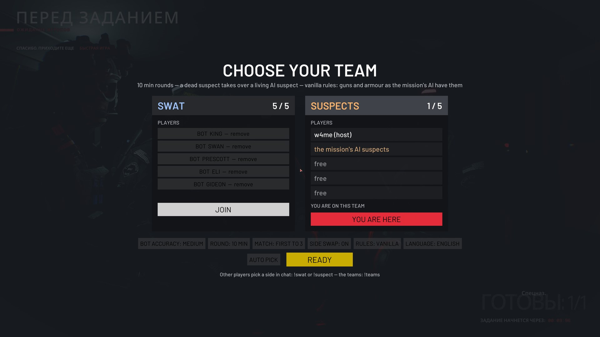
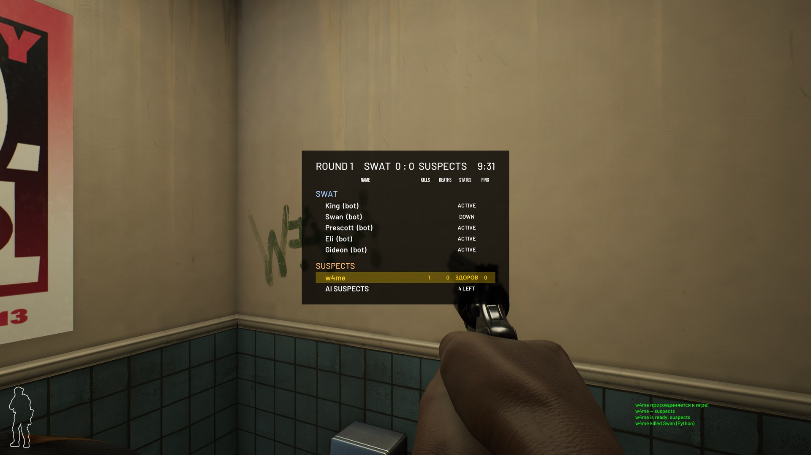
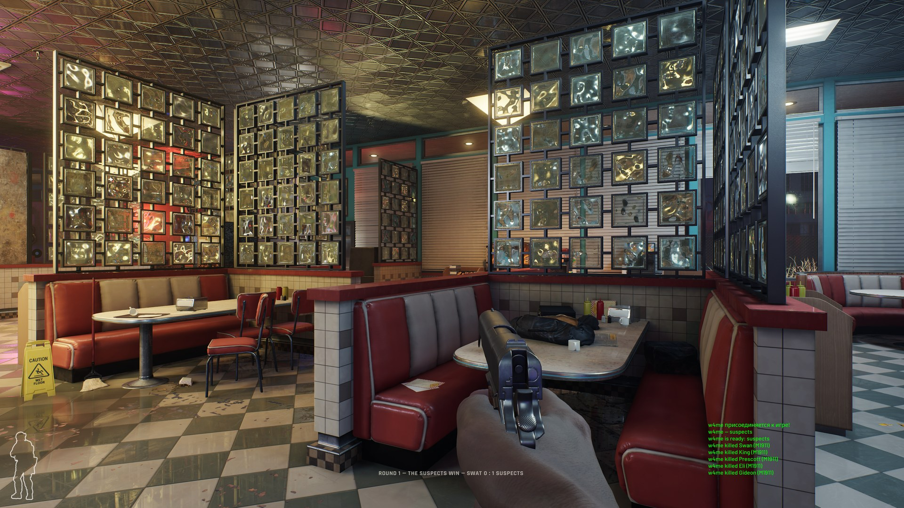
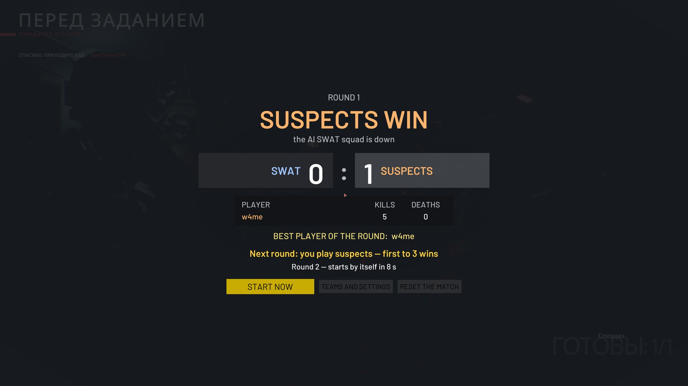

<p align="center"></p>

# Ready or Not PvP — SWAT vs Suspects

   

> [!WARNING]
> **This is an alpha version.** The mode is playable, but it has bugs and has seen little testing against live
> opponents. Found a bug or a crash?
> **Report it in [Issues](https://github.com/VolkovIlia/ReadyOrNot-PvP/issues/new/choose)** and attach the logs
> (where to find them: [below](#report-a-bug)). Every report helps.

The mod turns any Ready or Not co-op mission into PvP: SWAT players against suspect players, in rounds with a
halftime side swap. **The host installs it from the game's own Mods menu: no other tools, nothing to download by
hand.** Friends subscribe too or turn on "Join modded servers" once.

An older version with a UE4SS installer still exists ([below](#legacy-ue4ss-installer)); it is no longer developed
and lacks the features of 0.3.0 and later.

| | |
|---|---|
|  |  |
|  |  |

## Features

- **Team selection** on the pre-mission screen of any co-op mission: SWAT and suspect cards, players, bot slots,
  match settings, «ГОТОВ» (Ready).
- **Rounds.** A match to N wins (3 by default). A round ends inside the mission, then the mission reloads.
  The mod's own round and match result screens replace the standard SWAT debriefing; sides swap at halftime.
- **Scoreboard on Tab** in the game's own style: the round, the score, the time left, every player's kills, deaths,
  status and ping, the AI officers and the AI suspects left.
- **Match stats:** a kill feed in chat; kills and deaths for the round and the match on the result pages, with the
  best player.
- **Russian or English:** the game's language at first, a switch in the menu.
- **Two rule sets**, picked by the host in the menu:
  - **vanilla**: the AI keep the armour and guns the mission gives them; a suspect player takes over the whole kit
    of the AI suspect he replaces: the player versions of its guns with its ammo and magazines, and its armour;
  - **balanced**: suspect players always get a rifle firing FMJ, and the AI SWAT squad wears a SWAT player's default
    Kevlar instead of its ceramic and steel plates.
- **Suspect players** spawn in place of AI suspects, with suspect weapons and clothes, without armour or SWAT gear.
  10 s after a death they take over another living AI suspect, as long as there are any left, and cannot be hurt
  for the first 3 s.
- **Suspects open any door**, locked ones too; SWAT still find a locked door locked and have to pick or breach it.
- **Suspects pick up dropped guns**: hold the evidence-collect key on a gun to take it into your hands.
- **SWAT bots:** up to five AI officers fill the free SWAT slots (the host picks them with a click), and with no
  SWAT players they hunt the suspects on their own. You can play alone against bots on either side.
- **Lobbies of up to 10 players** (5v5) instead of the standard 5.

## Install from the Mods menu (pak)

1. In the game's main menu open **Mods**, find **PvP - SWAT vs Suspects**
   ([mod.io page](https://mod.io/g/readyornot/m/pvp-swat-vs-suspects)), subscribe, then restart the game.
   Without the menu: download `RoNPvP-…-modio.zip` from
   [Releases](https://github.com/VolkovIlia/ReadyOrNot-PvP/releases) and put `RoNPvP.pak` into
   `<game folder>\ReadyOrNot\Content\Paks\~mods\`.
2. Friends: subscribe to the mod **or** turn on Settings > Game > "Join modded servers" once. The game marks a host
   lobby with mods as "modded" and does not show it otherwise.
3. Start a co-op mission: the team menu opens on the pre-mission screen.

The mod needs nothing but the game: its logic is started by the game's own mod mechanism (`ModActorSpawnData`).

## Legacy: UE4SS installer

Not developed since 0.2.1: no rule sets, doors or gun pickup. It filters suspects' radio reports and yells and limits
spectating to one's own team on every client, which the Mods-menu version cannot do. If both are installed, the installer version
leaves the mission to the Mods-menu version, **but its native code still loads and freezes the AI SWAT squad**: with
the Mods-menu version, uninstall it (or delete `Mods\HostBrain\enabled.txt`).

<details>
<summary>Install with the installer</summary>

1. Close the game.
2. Download `RoN-PvP-…-alpha.zip` from [Releases](https://github.com/VolkovIlia/ReadyOrNot-PvP/releases)
   and unzip it into any folder.
3. Run **`Install.bat`**. It finds the game through Steam and installs the mod together with the
   [RE-UE4SS](https://github.com/UE4SS-RE/RE-UE4SS) loader. If UE4SS is already installed, the installer leaves it
   alone.
   - If Windows warns about an unknown publisher: "More info" > "Run anyway".
   - If the game is not found, the installer asks for its path: Steam > Ready or Not > "Manage" > "Browse local files".
4. Start the game and begin a co-op mission: the team menu opens on the pre-mission screen.

Uninstall: run `Uninstall.bat` from the same archive. It removes the mod, and UE4SS too unless other mods need it.
Update: run `Install.bat` of the new version; your settings are kept.

<details>
<summary>Manual install</summary>

1. Install [RE-UE4SS experimental](https://github.com/UE4SS-RE/RE-UE4SS/releases/tag/experimental-latest)
   (tested with `v3.0.1-1183-gcdbc0b66`): extract the archive into `<game folder>\ReadyOrNot\Binaries\Win64\`, so that
   `dwmapi.dll` and the `ue4ss` folder end up next to `ReadyOrNotSteam-Win64-Shipping.exe`.
2. From the mod archive, copy `game\ue4ss\Mods\HostBrain` into `<game folder>\ReadyOrNot\Binaries\Win64\ue4ss\Mods\`.
3. After you start the game, `ue4ss\UE4SS.log` should contain the line `[HostBrain] … loaded`.
</details>

Antivirus software may flag `dwmapi.dll`: it is the UE4SS loader, and this is how it gets into the game.
The game console (`~`) is needed only for the commands in [Host commands](#host-commands-legacy-installer); it is
enabled by `ConsoleEnablerMod`, which ships with UE4SS.
</details>

## How to play

1. The host starts the game with the mod and creates a lobby in Multiplayer; friends join. Lobbies created after the
   mod has loaded have 10 slots.
2. The host picks any co-op mission (for example, "Elephant" on the campus). On the pre-mission screen the host gets
   the "Choose your team" menu (in the game's language; the language button switches it):
   - "Join" on the SWAT or suspect card; "Auto pick" puts you in the smaller team;
   - bot slots on the SWAT card: a click on a bot takes it away, a click on a free slot adds one;
   - settings: bot accuracy, round time (3–30 min), match length (first to N wins), side swap, rules (vanilla or
     balanced), language;
   - "Ready": the mission waits for this button.

   The other players pick a side in chat: `!suspect` or `!swat`; `!teams` shows the teams.
3. The round starts. If nobody picked the suspects, it is a normal co-op mission. Hold **Tab** for the scoreboard.
4. After a round the host sees a results page with the score, everyone's kills and deaths, the best player and a
   countdown; the next round starts by itself after 8 s. After the deciding round the page shows "Match over" and a
   "New match" button.

Playing alone: start a co-op mission, press «ВСТУПИТЬ» (Join) on the suspect card, then «ГОТОВ» (Ready). You fight
together with the AI suspects against the AI SWAT squad, and after the side swap you play SWAT with the bots.

## Rules

- **SWAT** play by the normal mission rules and do not respawn during a round. SWAT win the round when all AI
  suspects and suspect players are neutralized and there is no AI suspect left to take over.
- **Suspects** win the round if all SWAT players are out (bots do not count; with no SWAT players, the whole AI
  squad) or the round time runs out.
- **Rounds.**
  - A round ends inside the mission, without the standard debriefing screen: the host gets the result as the game's
    objective popup, clients in chat. 6 s later the picture and the sound fade to black, the game's loading screen
    comes up and the mission loads again.
  - Sides swap after round N−1 (after the second round in a match to 3 wins); the score moves with the players.
- **A suspect** spawns in place of a random AI suspect, and that AI leaves the mission.
  - Weapons are the player versions of the AI's guns (AKM → SLR-47, G3 → FAL, Calico → MP5, Makarov → M92, and so
    on). Vanilla rules keep the AI's kit as it is. Balanced rules make the primary always a rifle firing FMJ (SMGs →
    SLR-47, shotguns → FAL, a random rifle when the AI had none): pistol calibres do not penetrate SWAT armour.
  - Armour: under vanilla rules the AI suspect's own vest and helmet, with the same protection; under balanced
    rules none. No NVGs, grenades or SWAT devices. The clothing is the game's own preset for a suspect player; it
    does not change the player's saved appearance.
- **Takeover.** 10 s after a death the player takes over a living AI suspect that no SWAT can see and that is more
  than 10 m away from them, and cannot be hurt for the first 3 s. When no AI suspects are left, the player spectates
  their own team until the round ends.
- **Bots.** A co-op mission spawns four AI officers (King, Swan, Prescott, Eli); the mod adds a fifth (Gideon) when
  five slots are free, and takes away the ones the host removed from the slots.
  - With a SWAT player alive, the bots follow and obey that player as in co-op.
  - With no SWAT player, they hunt. The game's AI does not take a squad led by a bot far, so the squad moves
    unseen: while no suspect player can see it and it is not fighting, it hops every 12 s to a doorway up to 16 m
    closer to the last sighting, gunshot or hint (a rough area around a suspect player every 30 s). It never lands
    within 9 m of a suspect player or in their sight, walks the last metres and fights on its own.
- **No mission score:** the host sets every mission score to 0, so nobody gets score or objective popups ("Reported
  suspect +10"), with or without the mod, and reports to TOC give nothing.
- **No cheating views:** helmet cameras and spectating keep to one's own side. A team camera of the other side is
  closed, and a dead player's spectator view moves on to their own side (this needs the mod on the player's machine).
- **Doors.** Suspects open any door, locked ones too (the game's own `Door.bSuspectAlwaysUnlocks` rule). A door
  that was locked locks again when a suspect closes it; SWAT still have to pick, breach or kick it.
- **Dropped guns.** A suspect who starts collecting a dropped gun as evidence (holds the use key on it) takes the
  gun at once instead: a SWAT gun as it is, an AI suspect's gun as its player version. It takes the place of the
  primary or the pistol and is drawn; the gun leaves the floor and no evidence bag appears.
- **The AI SWAT squad** keeps its own ceramic and steel plates under vanilla rules; no round in the game penetrates
  them in the torso. Under balanced rules it wears the default SWAT player armour (Kevlar). Bots have more health
  than players either way (250 vs 160).

## Host commands (legacy installer)

The Mods-menu version is run from its menu and the chat (`!swat`, `!suspect`, `!teams`). The legacy installer
version also has console commands:

```
comp_pvp here|<map> [minutes] [bots|nobots]   turn the mode on manually (here = on this mission)
comp_pvp_auto on|off              team menu on the pre-mission screen of any co-op mission (on by default)
comp_pvp_team <player|me> swat|suspect
comp_pvp_time 10 10               round time, min, and takeover delay, s
comp_pvp_bots on|off [accuracy]   AI SWAT squad and its accuracy (1 = normal, higher = worse)
comp_pvp_rounds [wins] [0|1]      match to N wins and side swap
comp_pvp_endround swat|suspects   end the current round as a win for that side
comp_pvp_status / comp_pvp_end    status / turn the mode off
comp_maxplayers [n]               slots in the next lobbies (10 by default, up to 16)
comp_status                       mod version, protections, game state
```
Settings are saved in `Mods\HostBrain\settings.txt`.

## Known limitations

- Network play against live opponents has seen little testing: see the [checklist](docs/pvp-playtest.md).
- A client sees the Tab scoreboard only with the mod installed; without it, a client gets the round events and the
  kill feed in chat.
- Chat lines from the mod (kill feed, round events for clients) are in the host's language.
- Suspect players can still yell "get down" and report to TOC: the game takes both from any player, and filtering
  them needs native code, which a Mods-menu mod cannot load. A report gives no score; the yell still reaches the AI
  around the player.
- A client without the mod can still open helmet cameras and spectate the other side: these views exist only on the
  player's machine.
- Suspects on clients still see the SWAT squad panel: it cannot be hidden on a vanilla client.
- If all players die in a round, the standard debriefing screen may flash for a second before the next round loads.
- SWAT players in ceramic or steel armour are almost invulnerable to suspects in the torso: aim for the head and
  limbs.
- A game update may break the mod: it relies on the game's internal functions.

## Report a bug

[Open an issue](https://github.com/VolkovIlia/ReadyOrNot-PvP/issues/new/choose) and attach from the host's machine:
- `%LOCALAPPDATA%\ReadyOrNot\Saved\SaveGames\RoNPvPLog.sav`, the mode's log;
- with the legacy installer version: `<game folder>\ReadyOrNot\Binaries\Win64\ue4ss\UE4SS.log` and
  `<game folder>\ReadyOrNot\Binaries\Win64\ue4ss\Mods\HostBrain\native\RonCompNative.log`;
- what you did, what you expected and what happened; a screenshot if something looked wrong.

## Development

Building, how the mod works and reverse-engineering findings: [docs/development.md](docs/development.md),
[docs/re-findings.md](docs/re-findings.md). Long-term plans (a mode with a bomb and an economy):
[docs/design.md](docs/design.md). Version history: [CHANGELOG.md](CHANGELOG.md).

## Legal

Unofficial fan mod, not affiliated with VOID Interactive. The repository contains no game assets; the mod does not
use leaked game source code and does not copy code from other mods. The code is licensed under [MIT](LICENSE).
